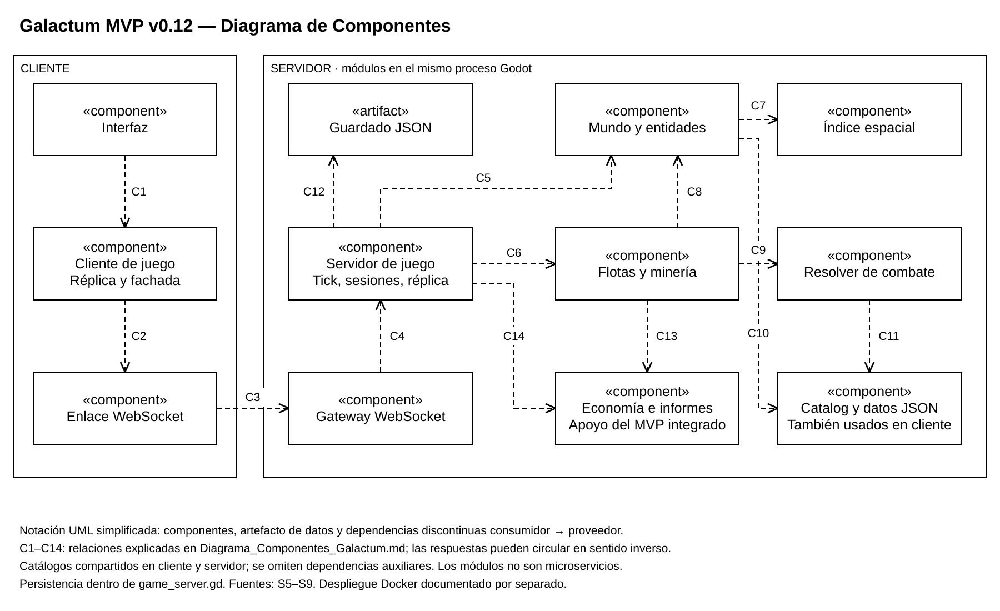

# Diagrama de Componentes de Galactum — Fase 2

## 1. Propósito y alcance

Módulos y dependencias del MVP v0.12. Se usa notación UML simplificada: componentes con estereotipo «component», artefacto de guardado y dependencias discontinuas dirigidas del consumidor al proveedor. Cliente y servidor son contextos lógicos, no contenedores. Las flechas no representan todos los intercambios de datos ni todas las referencias de código.

## 2. Diagrama

[Editable diagrams.net](Diagramas/Diagrama_Componentes_Galactum.drawio) · [PNG](Diagramas/Diagrama_Componentes_Galactum.png) · [Modelo editable](Diagramas/Diagrama_Componentes_Galactum.json) · [Generador](Diagramas/Generar_Diagramas.ps1).

## 3. Componentes y fuentes

Las rutas siguientes son relativas a mvp-v0.12 del repositorio técnico y se publican sin su código. S9 identifica el objeto revisado; S5 ya describe públicamente las responsabilidades principales.

| Componente | Referencia real | Responsabilidad e interfaz | Dependencias |
| --- | --- | --- | --- |
| Interfaz | ui/ | Selección, composición, mapa e informes; acciones y señales de la fachada | Cliente de juego |
| Cliente de juego | client/game_client.gd | Réplica no autoritativa; intent(), set_view(), señales de estado y resultados | WsLink en modo dedicado; LocalLink en modo embebido |
| Enlace WebSocket | client/links/ws_link.gd | Apertura, polling, envío/recepción JSON, señales de conexión | Gateway por WebSocket; WebSocketPeer de Godot |
| Gateway WebSocket | server/net/ws_gateway.gd | Aceptar conexiones, abrir/cerrar sesiones y despachar mensajes | GameServer: open_session(), handle_message(), close_session() |
| Servidor de juego | server/game_server.gd | Sesiones, validación, tick, réplica, estado raíz y guardado/carga | World, Fleets, módulos de apoyo, Catalog y JSON |
| Mundo | server/sss/world.gd | Entidades, terreno, spawn y visibilidad | SpatialHash y Catalog |
| Índice espacial | server/sss/spatial_hash.gd | Inserción/movimiento y consultas por rectángulo/radio | Identificadores y posiciones entregados por mundo |
| Flotas y minería | server/sss/fleets.gd | Marchas, llegadas, minería, recall, retorno y encuentros | Mundo, resolver, economía e informes a través del servidor, Catalog |
| Resolver de combate | server/combat/combat_resolver.gd | resolve() y resolve_hunt(); resultado calculado, sin red propia | Catalog: estadísticas y reglas |
| Economía e informes de apoyo | server/sgm/economy.gd y server/reports.gd | Aplicar entregas con clave de flota y registrar resultados; apoyo existente del MVP | Estado del servidor y datos de balance |
| Catalog y datos JSON | shared/catalog.gd y data/ | Cargar y consultar configuración y estadísticas; Autoload ya existente | Archivos de catálogos, separados del guardado |

El artefacto galactum_server_save.json guarda estado; no es un servicio SQL. Su versión comprobada es SAVE_VERSION 5. La escritura temporal y el renombrado pertenecen a GameServer. app/boot.gd compone servidor y gateway en modo dedicado; se explica como arranque, sin convertirlo en microservicio.

## 4. Relaciones dibujadas

| ID | Consumidor → proveedor | Significado y comprobación |
| --- | --- | --- |
| C1 | Interfaz → cliente de juego | La UI usa la fachada; esta emite señales de réplica e informes. S5/S9 |
| C2 | Cliente de juego → WsLink | Selecciona el enlace remoto y usa sus señales/envío. S9 |
| C3 | WsLink → gateway | Consume el protocolo JSON/WebSocket del servidor. Respuestas por la misma conexión. S9; proxy web según S7 |
| C4 | Gateway → GameServer | Abre sesiones y llama al despachador; el sink devuelve mensajes. S9 |
| C5 | GameServer → mundo | Gestiona el estado activo y consulta entidades para visibilidad y réplica. S9 |
| C6 | GameServer → flotas | Despacha march/recall/relocate y ejecuta tick(). S9 |
| C7 | Mundo → índice espacial | Mantiene y consulta el índice de posiciones. S9 |
| C8 | Flotas → mundo | Usa srv.world para objetivos, cambios y respawn. S9 |
| C9 | Flotas → resolver | Invoca resolve_hunt()/resolve() para encuentros y usa datos de carga/velocidad. S9 |
| C10 | Mundo → Catalog | Lee definiciones del mapa, asteroides y xenoformas. S9 |
| C11 | Resolver → Catalog | Consulta estadísticas y reglas de combate. S9 |
| C12 | GameServer → guardado JSON | Lee/restaura y escribe estado mediante FileAccess; no hay SQL. S9 |
| C13 | Flotas → apoyo económico/informes | Aplica entrega y bajas; solicita informes a través de srv.reports. S9 |
| C14 | GameServer → apoyo económico/informes | Compone estos módulos y coordina estado y reglas integradas. S9 |

Catalog existe en ambos contextos. Se dibuja una sola caja para describir la responsabilidad compartida: no es un servicio remoto ni un estado mutable compartido entre procesos. Cliente, flotas y servidor también lo utilizan; esas dependencias se indican en la tabla y se omiten gráficamente para preservar legibilidad. Los módulos sociales, de progresión, misiones, bots y otros apoyos no se desglosan por quedar fuera del foco de esta vista.

## 5. Interfaces y despliegue

El protocolo del MVP es galactum-mvp-1. Cliente → servidor: hello, view e intent; las acciones de Mundo y Combate incluyen march, recall y relocate. Servidor → cliente: welcome, player, map_delta, report, ack y error; el MVP también tiene notificaciones adicionales. request_id correlaciona respuestas, pero no demuestra por sí solo idempotencia.

En Docker, la UI, fachada y WsLink se ejecutan en el navegador como cliente exportado. web contiene Nginx y recursos estáticos, y reenvía /ws. server ejecuta gateway, GameServer y sus módulos en Godot headless. El volumen conserva el JSON bajo /data. Véase [correspondencia de despliegue](CORRESPONDENCIA_DOCKER.md).

## 6. Fuentes y pendientes

[Catálogo S1–S9 y diagnóstico](DIAGNOSTICO_Y_FUENTES.md). La lógica se inspeccionó directamente en S9; las capturas previas son evidencia de acciones observadas, no de todas las reglas. No se ejecutaron suites del juego durante esta tarea. Falta acceder al commit de configuración Docker/adaptación web y confirmar con el docente la notación de la entrega. El equipo debe revisar los diagramas; no se declara que Juan ya los haya aprobado o expuesto.
