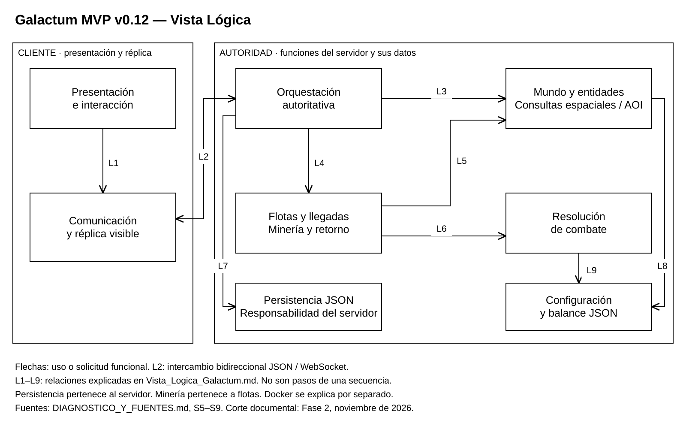

# Vista Lógica de Galactum — Fase 2

## 1. Propósito y alcance

Organización funcional del MVP v0.12, Godot 4.6.2, con foco en Mundo y Combate. Esta vista conceptual separa presentación, réplica, autoridad y datos. No es un dibujo de Docker ni se presenta como UML formal. La interfaz y los sistemas de apoyo del MVP integrado no se atribuyen íntegramente al Equipo 3.

## 2. Diagrama

[Editable diagrams.net](Diagramas/Vista_Logica_Galactum.drawio) · [PNG](Diagramas/Vista_Logica_Galactum.png) · [Modelo editable](Diagramas/Vista_Logica_Galactum.json) · [Generador](Diagramas/Generar_Diagramas.ps1).

## 3. Elementos

| Elemento | Responsabilidad | Respaldo |
| --- | --- | --- |
| Presentación e interacción | Mostrar nave, mapa, composición e informes; convertir acciones en solicitudes | S5 Parte 1; S6 A; S9 ui/ |
| Comunicación y réplica | Mantener copia visible, enviar intenciones y notificar a la interfaz | S9 game_client.gd y ws_link.gd |
| Orquestación autoritativa | Sesiones, validación, tick, publicación de estado e informes | S9 game_server.gd |
| Mundo y entidades | Entidades, terreno, asteroides, xenoformas y consultas espaciales/AOI | S9 world.gd y spatial_hash.gd |
| Flotas y minería | Marchas, llegadas, extracción por tiempo/tasa, cancelación y retorno | S9 fleets.gd |
| Resolución de combate | Calcular resultados PvE/PvP para que la autoridad los aplique | S9 combat_resolver.gd |
| Persistencia JSON | Guardar/restaurar el estado; responsabilidad del mismo servidor | S9 game_server.gd, save() y _load() |
| Configuración y balance | Definiciones y parámetros JSON, separados del estado de partida | S9 shared/catalog.gd y data/ |

## 4. Relaciones

Las flechas continuas son solicitudes o uso funcional. L2 representa intercambio bidireccional. No forman una secuencia temporal de nueve pasos ni un grafo exhaustivo de llamadas.

| ID | Origen → destino | Significado |
| --- | --- | --- |
| L1 | Presentación → réplica | Solicitar acciones y consultar estado; las señales de la réplica notifican los cambios a la interfaz |
| L2 | Réplica ↔ autoridad | JSON/WebSocket: solicitudes hello, view e intent; retorno de estado, informes y ack/error |
| L3 | Autoridad → mundo | Consultar/actualizar entidades y construir la visibilidad de cada sesión |
| L4 | Autoridad → flotas | Despachar órdenes y avanzar marchas desde el tick |
| L5 | Flotas → mundo | Consultar objetivos, ocupar/agotarlos y actualizar su estado |
| L6 | Flotas → combate | Resolver encuentros y aplicar sus resultados |
| L7 | Autoridad → persistencia | Guardar/cargar el estado que administra, dentro del mismo proceso |
| L8 | Mundo → configuración | Usar definiciones de entidades, mapa y objetivos |
| L9 | Combate → configuración | Usar estadísticas y reglas de balance |

La vista prioriza el recorrido de Mundo y Combate. Otras dependencias de datos y los módulos de economía/informes se desarrollan en el Diagrama de Componentes.

### Minería

El jugador selecciona un asteroide y compone tropas. El cliente solicita una marcha de recolección mediante intent. El servidor valida jugador, tropas, estado y objetivo; flotas gestiona la llegada, ocupación, tasa/capacidad, extracción y retorno. El módulo económico integrado aplica la entrega con una clave de la flota. El cliente representa las actualizaciones autoritativas. La revisión del código acredita la presencia de estas reglas; no sustituye pruebas ejecutadas de exclusividad o idempotencia.

### Combate

El jugador selecciona una xenoforma y solicita la marcha de caza. Flotas administra el encuentro, invoca el resolver y procesa daño, recompensas y heridos con los módulos de apoyo. El servidor entrega estado e informe al cliente. Las figuras de S6 registran una caza observada; el determinismo requiere una prueba específica aunque el resolver use semilla y versión.

### Sincronización

El cliente comunica el área mediante view. El servidor consulta mundo/índice espacial y compara el conjunto visible de la sesión para publicar map_delta: added, updated y removed. La fachada actualiza la réplica y emite señales a la UI. Removed también puede significar salida del AOI. La posición visual se deriva del tiempo y no autoriza cambios de estado.

## 5. Relación con el despliegue

El navegador ejecuta presentación, réplica y transporte del cliente WebAssembly/WebGL. Nginx, en web, sirve sus archivos y reenvía /ws hacia server:9100. El servidor Godot headless ejecuta autoridad, mundo, flotas, combate y persistencia. El JSON reside en el volumen montado en /data. Esta correspondencia no transforma funciones lógicas en servicios independientes.

## 6. Fuentes y límites

Referencias S1–S9 en [diagnóstico](DIAGNOSTICO_Y_FUENTES.md). La lógica se comprobó en el subárbol mvp-v0.12 del objeto técnico 7359026. Docker y la adaptación /ws se sustentan en S5–S8; falta cotejar su configuración exacta. No se ejecutó el juego ni sus suites en esta tarea. La evidencia previa demuestra stop/start, no recreación ni borrado del volumen.
