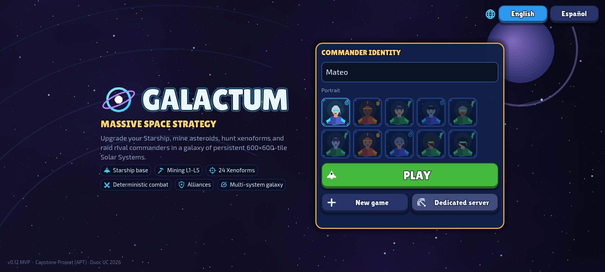
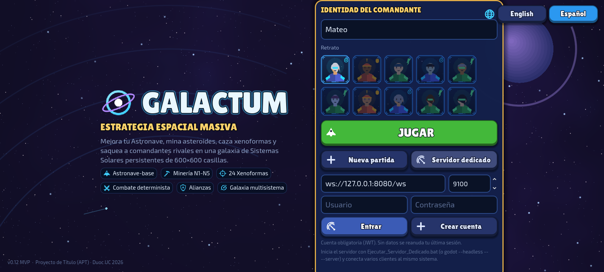
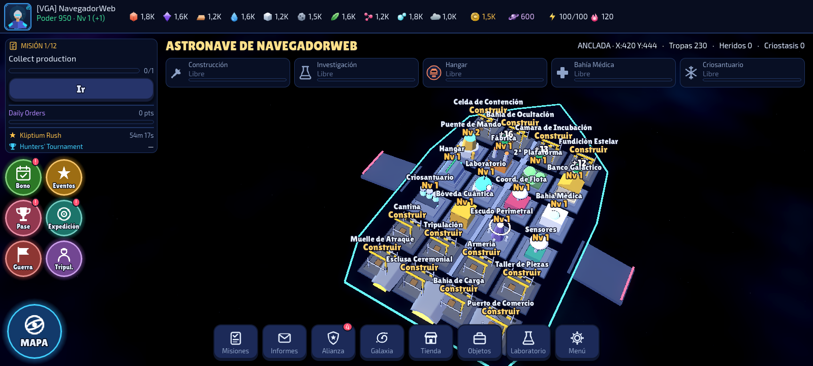

# Registro de verificación de Docker — 10 de noviembre de 2026

Galactum MVP v0.12 · repositorio técnico Drfiter/galactum · carpeta `mvp-v0.12/` · commit `4449471`.

## Qué cambió respecto del 3 de noviembre

El registro del 3/11 ([Fase 2](../../Fase%202/Evidencias%20Proyecto%20%28version%20Agil%29/REGISTRO_VERIFICACION_DOCKER.md)) documentó un ciclo stop/start, pero los archivos Docker no estaban en el repositorio técnico. El 10/11 se versionaron (commit `aa375ad`) y se verificó la configuración completa:

| Archivo | Función |
|---|---|
| `compose.yaml` | Servicios `server` y `web`, volumen `galactum-data`, puertos 127.0.0.1:9100 y 127.0.0.1:8080, secreto JWT desde `.env` |
| `docker/Dockerfile` | Multi-etapa: `base` (Godot 4.6.2 headless + proyecto importado), `server`, `webexp` (exportación HTML5) y `web` (nginx) |
| `docker/nginx.conf` | Sirve el cliente web y reenvía `/ws` al servidor (WebSocket); resuelve `server` en cada conexión |
| `docker/healthcheck.py` | Comprueba la salud del servidor con un handshake WebSocket real |
| `.env.example` | Plantilla de `GALACTUM_JWT_SECRET` (el `.env` real no se versiona) |

## Pasos verificados

| Paso | Acción | Resultado |
|---|---|---|
| 1 | `docker compose build` (imágenes `server` y `web`) | `galactum-server:0.12` (460 MB) y `galactum-web:0.12` (148 MB) |
| 2 | `docker compose up -d` | `server` *healthy*; `web` arranca después de que el servidor está sano |
| 3 | `curl http://127.0.0.1:8080/` y `/index.wasm` | 200 `text/html` y 200 `application/wasm` |
| 4 | Registro de cuenta a través de nginx (`ws://127.0.0.1:8080/ws`) | Conectado, flota enviada |
| 5 | Login con contraseña incorrecta | Rechazado: "usuario o contraseña incorrectos" |
| 6 | Conexión sin cuenta | Rechazada: el servidor exige una cuenta |
| 7 | `docker compose down` y `docker compose up -d` (contenedores recreados) | "Estado restaurado desde user://galactum_server_save.json"; la misma cuenta vuelve a entrar con el mismo comandante |
| 8 | Chromium (WebGL 2) en http://localhost:8080 | Carga el juego, completa sola `ws://127.0.0.1:8080/ws`, crea la cuenta y entra a la partida |

Salida completa de los comandos: [docker_verificacion_2026-11-10.txt](../../docs/pruebas/docker_verificacion_2026-11-10.txt).

## Capturas del navegador

| | |
|---|---|
|  |  |
| Cliente web servido por nginx | La dirección del mismo origen (`/ws`) se completa sola |

Cuenta creada desde el navegador y partida cargada desde el contenedor.

## Entorno y límites

- Linux con Docker Engine 29.9.2 y Compose 5.6.1. En Windows se usa Docker Desktop con los mismos comandos (`copy .env.example .env`).
- Para la prueba, las descargas de Godot y de sus plantillas se sirvieron desde una copia local mediante los argumentos `GODOT_URL` y `TEMPLATES_URL`; por defecto el Dockerfile las descarga de GitHub.
- No se probó HTTPS ni un despliegue en la nube, ni carga con muchos clientes simultáneos.
- Borrar el volumen (`docker compose down -v`) reinicia el mundo y las cuentas: el volumen no reemplaza un respaldo.
